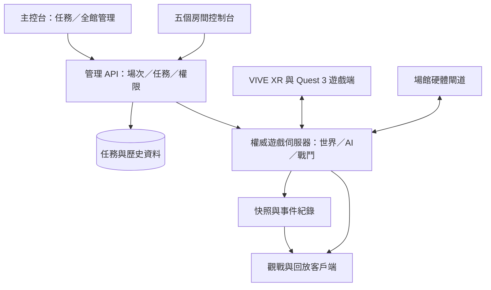

# 架構方向

## 控制與遊戲模擬分工

圖為目標架構。v0.3 已實作控制台認證與範圍授權、管理 API、任務 JSON 檔、場次生命週期與持久化管理事件，其他節點待開發。事件與狀態契約見 `SESSION_PROTOCOL.md`；身分與權限見 `AUTHORIZATION.md`。

管理 API 處理低頻設定與場次生命週期；頭部／手部姿態、射擊與 AI 不經此 REST API 做每幀同步。後續遊戲伺服器負責權威命中判定、AI、環境狀態與事件排序。網路框架須在 Unity 雙裝置原型實測後決定，尚未承諾第三方付費服務或授權。

獨立模式每房對應一個隔離的遊戲世界；全連線模式五房映射到一個共同世界。切換模式須先結束受影響場次，再重新指派；不在進行中熱合併既有世界。觀戰者以唯讀身分接入，不占用 25 個玩家名額。

## 雙平台策略

初步選擇 Unity 與 C#；以 OpenXR 為共同頭盔與控制器介面。依雙平台實測選定並固定 Unity Editor、OpenXR、互動工具與廠牌套件版本，建立可重現的兩個 Android build profile。目前環境未找到 Unity Editor，因此本庫尚無 Unity 工程或 Android 安裝包。

Meta 的官方文件提供 OpenXR 開發流程；VIVE 的 OpenXR SDK 包含 Android AIO 頭盔開發路徑。這是技術選型依據，並非本專案已通過跨平台測試：

- [Meta XR Plugin Management](https://developers.meta.com/vr/documentation/unity/unity-xr-plugin/)
- [Unity Meta Quest workflow](https://docs.unity3d.com/6000.0/Documentation/Manual/xr-meta-quest-develop.html)
- [VIVE OpenXR Unity Overview](https://developer.vive.com/resources/openxr/unity/overview/)

MR 功能需以 `IXrPlatform` 類型的介面分隔透視、錨點、場地網格、邊界與定位校正能力。每房維護 room-to-world 轉換與校正版本；全連線時傳送遊戲世界座標。不同廠牌的原生錨點不可直接視為共用格式。MR 的「夜間／天氣」視覺作用於虛擬內容，實體世界透視效果須依平台能力另外設計。

後端採 .NET 10，與 Unity 執行環境分開。共用資料使用版本化 JSON 契約；若新增共用 C# 套件，需另選 Unity 支援的目標框架與語法，避免直接參考 `VrCommand.Core` 的 .NET 10 組件。

## 任務、即時控制與歷史

任務模板保存名稱、內容、時間、環境、敵軍與擺設。建立場次時以事件保存模板快照；場次執行設定可獨立變更，不影響模板或其他場次。尚無模板修改 API。

正式版須增加任務版本、資產版本、內容雜湊、操作者、建立／修改時間與校正版本。即時環境與 AI 命令由伺服器發出有序事件，含命令 ID、目標場次、操作者、序號與伺服器時間，允許重試去重且受房間權限約束。

回放採週期世界快照加事件紀錄，含玩家姿態、AI／投射物、擺設、天氣、傷害與生命週期；回放由快照重建狀態並重播後續事件，不依賴重新運行 AI 得到相同結果。需保留資產與規則版本，明確處理資料缺口。3D 回放完成後才評估額外的影片錄製與匯出。

統計從同一批經權威確認的戰鬥事件彙總；事件去重與玩家場次身分避免重送造成灌水。回放中的結果應與任務結束報表一致。硬體原始事件須先經閘道驗證及遊戲規則判斷，不能直接視為擊殺或命中。

## 主要開發依賴

Unity 與 Android 工具鏈、兩種頭盔實機、場館尺寸與網路配置、素材與模型來源、硬體協議、管理與遊戲端部署機規格。初步以 LAN 與 Android 一體機為工作假設；若改採 PCVR，須調整效能與部署驗收。
