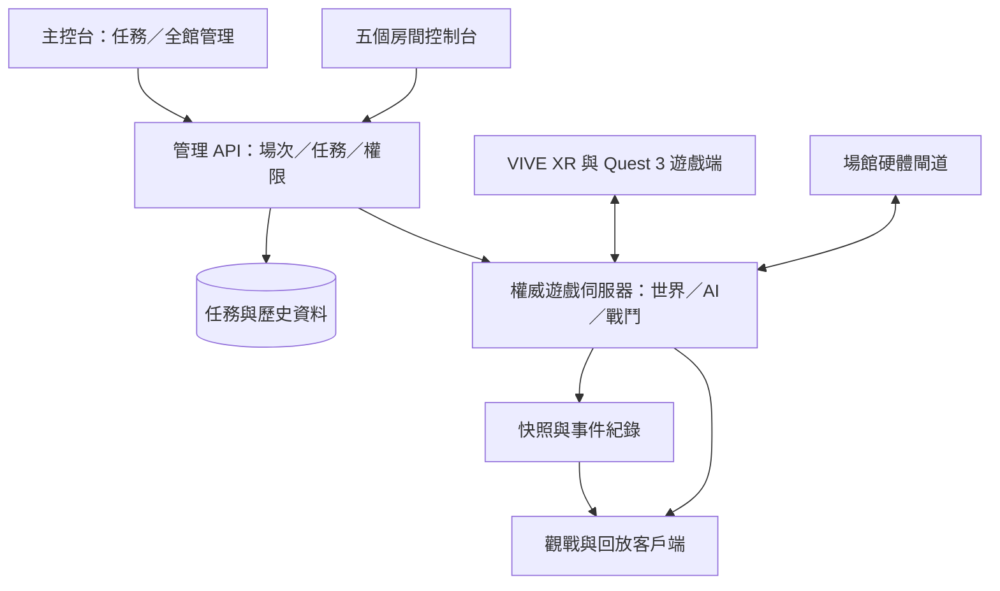

# 架構方向

## 控制與遊戲模擬分工

圖為目標架構。管理、SQLite／統計、票券及 `/console/` 操作已有驗證；瀏覽器可從實際模擬紀錄進行 3D 回放。v0.10 的 ArenaSession 與射擊／掩體／AI 使用相同 .NET Standard 核心，Unity 的 CombatAuthority／輸入／渲染／HUD 已有呼叫它的來源碼，仍無 Unity 編譯或運行證據。v0.11 的持久 outbox、補送及封存已通過 .NET／HTTP；Unity 發送仍待編譯運行，正式世界儲存、頭盔錄影及即時觀戰待做。接入與限制見 `GAMEPLAY.md`，規則／回放見 `SIMULATION.md`／`REPLAY.md`。

管理 API 處理低頻設定與場次生命週期；頭部／手部姿態、射擊與 AI 不經此 REST API 做每幀同步。原型選用 NGO 2.7.0／Unity Transport，桌面伺服器向管理 API 驗票及讀取設定，頭盔只帶短效玩家票券。後續遊戲伺服器負責權威命中判定、AI、環境狀態與事件排序。網路框架仍須雙裝置實測評估，尚未承諾第三方付費服務。

獨立模式每房對應一個隔離的遊戲世界；全連線模式五房映射到一個共同世界。切換模式須先結束受影響場次，再重新指派；不在進行中熱合併既有世界。觀戰者以唯讀身分接入，不占用 25 個玩家名額。

## 雙平台策略

依 2026-10-29 使用者指示，先以 Meta Quest 3 完成遊戲垂直切片，再接 VIVE；目前 Android 獨立執行為尚待實機確認的部署假設。

選擇 Unity 與 C#，以 OpenXR 為共同頭盔與控制器介面。Quest 原型固定 Editor 6000.3.27f1、OpenXR 1.19.0 等版本，見 `QUEST3.md`。Editor 及 Android 工具在 F 槽，已依使用者同意安裝／整理並通過原生 ARM64 編譯。Editor 仍未取得有效授權，Prepare 退出 198；工程沒有 Unity 編譯或 APK 證據，更沒有跨平台實測。

Meta 的官方文件提供 OpenXR 開發流程；VIVE 的 OpenXR SDK 包含 Android AIO 頭盔開發路徑。這是技術選型依據，並非本專案已通過跨平台測試：

- [Meta XR Plugin Management](https://developers.meta.com/vr/documentation/unity/unity-xr-plugin/)
- [Unity Meta Quest workflow](https://docs.unity3d.com/6000.0/Documentation/Manual/xr-meta-quest-develop.html)
- [VIVE OpenXR Unity Overview](https://developer.vive.com/resources/openxr/unity/overview/)

MR 功能需以 `IXrPlatform` 類型的介面分隔透視、錨點、場地網格、邊界與定位校正能力。每房維護 room-to-world 轉換與校正版本；全連線時傳送遊戲世界座標。不同廠牌的原生錨點不可直接視為共用格式。MR 的「夜間／天氣」視覺作用於虛擬內容，實體世界透視效果須依平台能力另外設計。

後端採 .NET 10，與 Unity 執行環境分開。共用資料使用版本化 JSON 契約；新共用戰鬥套件使用 .NET Standard 2.1／C# 9，同一份 Runtime 來源同時供 embedded package 與 .NET 建置入口使用，避免直接參考 `VrCommand.Core` 的 .NET 10 組件。只有 .NET 核心完成型別綁定與執行驗證，Unity 匯入及 IL2CPP 仍須實測。

## 任務、即時控制與歷史

任務模板保存名稱、內容、時間、環境、敵軍與擺設。建立場次時以事件保存模板快照；場次執行設定可獨立變更，不影響模板或其他場次。尚無模板修改 API。

v0.15 已有任務不可變版本、series／parent、作者與建立時間，存在獨立 SQLite catalog；場次保留精確版本，見 MISSION_VERSIONS。資產版本、內容雜湊與校正版本仍須增加。即時環境與 AI 命令由伺服器發出有序事件，含命令 ID、目標場次、操作者、序號與伺服器時間，允許重試去重且受房間權限約束。

回放採週期世界快照加事件紀錄，含玩家姿態、AI／投射物、擺設、天氣、傷害與生命週期；回放由快照重建狀態並重播後續事件，不依賴重新運行 AI 得到相同結果。需保留資產與規則版本，明確處理資料缺口。3D 回放完成後才評估額外的影片錄製與匯出。

統計已從同一份版本化事件紀錄增量彙總，可重建射擊、命中、擊殺、傷害與血量。去重、射擊歸屬及命中前置已驗證，模擬與遊戲來源標記不能在同場混用。實際碰撞／敵軍生命值判定仍待權威伺服器實作；正式回放結果須與任務結束報表一致。硬體原始事件不能直接視為擊殺或命中。

## 主要開發依賴

Unity 與 Android 工具鏈、兩種頭盔實機、場館尺寸與網路配置、素材與模型來源、硬體協議、管理與遊戲端部署機規格。初步以 LAN 與 Android 一體機為工作假設；若改採 PCVR，須調整效能與部署驗收。
