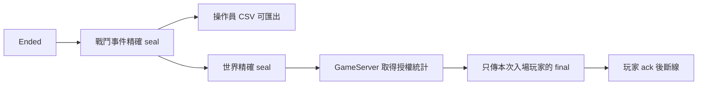

# 結束後的封存與最終戰績失聯

此工具使用自己新建的API及真正Windows server／headless client，先由真正AI造成非零傷害，再Pause／End。它只對server所用的代理中斷一條明確HTTP路由，NGO UDP、管理GET與操作員觀察維持正常；沒有注入姿態／武器／統計，也不碰正式5080。來源為Simulation，結果以 PROGRESS／本次 artifacts 為準。

`combat-seal`只對原stream的POST seal回503，原batch仍可補送，管理照常取得Ended。至少8秒內combat sealed=false、statistics.pendingTelemetry=true、world complete=false，CSV須409；玩家只能pending、不能有final或提早斷線。恢復後原請求正常重試，雙seal／個別結果／ack及完整回放、CSV必須與原入場和ledger一致。

`statistics`只阻斷GameServer讀取最終statistics的GET。此時兩份journal應已封存，API的pendingTelemetry=false；玩家仍不能憑本地預測製造final。操作員直接讀取的API與CSV政策保持原樣，不把已封存的數字標成未封存。恢復後GameServer重新取得授權統計，target送出原玩家的正確結果並ack。



CSV的既有政策只要求Ended及戰鬥事件seal；玩家結果還要等待世界seal與GameServer讀回。工具按這兩個原有邊界檢查，沒有為測試改成同一種完成條件。

每類故障只維持約8秒，仍受代理20秒fault／240秒lifetime上限及原玩家結果30秒等待（進行中HTTP最多另5秒）約束；沒有延長遊戲期限。這只驗可恢復短暫失聯，不是封存超過期限、API／server crash或所有ACK丟失情境。

代理新增兩個明確mode，沿用8連線／有界body／opaque WS、不記payload或認證、所有request handlers必須join的規範。原management／publication模式的語意不變，舊試跑保留自己的tool fingerprint，不覆寫成新指紋。

```powershell
$env:VR_COMMAND_API_DLL = "$PWD/artifacts/build-clock-v1/bin/VrCommand.Api/release/VrCommand.Api.dll"
python scripts/check-desktop-seal-faults.py --runtime-root "$env:LOCALAPPDATA/VrCommand/SimulationRuns" --mode combat-seal
python scripts/check-desktop-seal-faults.py --runtime-root "$env:LOCALAPPDATA/VrCommand/SimulationRuns" --mode statistics
```

每場各自全新資料與憑證，C SSD runtime／F source及binary；`complete=true`須在代理／所有writer停止、tool fingerprint不變及一次snapshot成功後才寫。所有失敗與原件保留，不把同機Simulation或封存成功當作完整頭盔／25台驗收。
