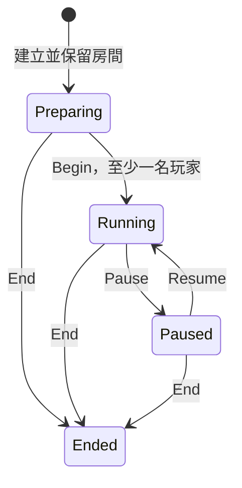

# 場次與事件契約 v0.2

本契約目前僅實作管理資料狀態。狀態為 `Running` 不代表已連接遊戲伺服器，`Pause` 尚不會停止頭盔畫面或硬體。

## 生命週期



建立時複製任務模板，`CreatedAtUtc` 記錄建立時間；`StartedAtUtc` 在首次 `Begin` 設定，恢復時不覆寫。`EndedAtUtc` 在結束時設定。所有事件時間由後端產生，以序號決定順序，不依賴裝置時鐘。

玩家只可在 `Preparing` 加入，在任一未結束狀態離開。沒有自動開局、倒數結束、斷線偵測、設備準備確認、重連席位或操作者授權。結束時保留當時名冊供歷史查閱，活動名額全部釋放；曾離開的玩家可從事件查閱。

`SetEnvironment` 與 `SetEnemies` 可用於任一未結束狀態。它們更新場次的執行設定，不修改任務模板，也不影響其他獨立場次。已結束的場次拒絕新操作；成功命令的原樣重送仍可查詢接受結果。

## 命令

`POST /api/sessions/{id}/commands`：

```json
{
  "commandId": "251227ab-bc64-4aca-9838-55db6f49dd99",
  "action": "Pause",
  "expectedSequence": 27
}
```

`expectedSequence` 可省略；有指定時必須符合伺服器目前序號，否則回傳 409，讓控制者重新載入再決定。命令重送的去重檢查優先於版本檢查，因此已接受的同一命令即使版本已前進仍能取得結果。

去重範圍是每場次。相同 ID 必須有完全相同的解析後內容，包含 `expectedSequence`；改變內容回傳 409。回應 `duplicate`、`appliedAtSequence` 表示是否重送及原始接受位置，`session` 一律為最新快照，而非原命令當時的舊狀態。新接受事件與去重資訊一起寫入磁碟，重啟後仍有效。

環境設定範例：

```json
{
  "commandId": "9904f941-aa41-4ca3-808e-8a7efb8677dc",
  "action": "SetEnvironment",
  "environment": { "mode": "VR", "weather": "Rain", "timeOfDay": "Night", "lightning": false }
}
```

敵軍設定範例：

```json
{
  "commandId": "111298ae-c5ce-4746-9e0b-17062e869fae",
  "action": "SetEnemies",
  "enemies": { "count": 8, "behavior": "Advance", "autoAttack": true }
}
```

與動作無關的設定欄位會回傳 400。`commandId` 不可為空 GUID，`action` 不可省略。尚無命令操作者身分；不能把此紀錄視為已認證的操作稽核。

## 事件讀取與持久化

`GET /api/sessions/{id}/events?after=0&limit=100` 回傳事件陣列。每場次從序號 1 開始，僅接受的變更會遞增；讀取端以最後收到的序號作為下一次 `after`，空陣列表示已讀到目前尾端。預設 100、最多 500 筆；沒有訂閱推播與長輪詢。

共同欄位為 `schemaVersion`（目前 1）、`eventId`、`sessionId`、`sequence`、`recordedAtUtc`、`kind` 及 `payload`。

| kind | payload | 用途 |
|---|---|---|
| `Created` | mode、roomIds、完整 mission | 建立事件與任務快照 |
| `PlayerJoined` | id、name、roomId、headset | 玩家加入名冊 |
| `PlayerLeft` | playerId | 玩家離開 |
| `ControlApplied` | 完整 ControlCommand | 生命週期或執行設定變更 |

檔案存放於 `SessionDataDirectory/{sessionId}.json`。每次管理變更先計算新狀態，再寫入暫存檔、flush 及替換原檔，成功後才更新記憶體。寫入失敗不推進狀態或釋放房間。單一目錄以 `.writer.lock` 防止另一個 API 程序同時寫入；不要手動更動正在使用的歷史檔。

服務啟動時從事件重建活動與歷史場次，驗證 schema、身分、連續序號、事件／命令 ID、狀態轉移與活動房間／玩家衝突。資料損壞或未知版本時啟動失敗，不靜默丟棄歷史。執行中的場次會恢復管理狀態；此行為尚不涵蓋遊戲世界、裝置重連或硬體恢復。

目前逐次重寫整份管理歷史，並在啟動時載入所有場次；適用於原型的低頻管理事件，尚無歷史保留／刪除介面或資料庫索引。正式遊戲的高頻姿態與戰鬥紀錄須使用另外的分段儲存／快照策略。事件尚不含世界位置、傷害與動畫，因此本功能不是需求第 9 項的 3D 任務回放。
