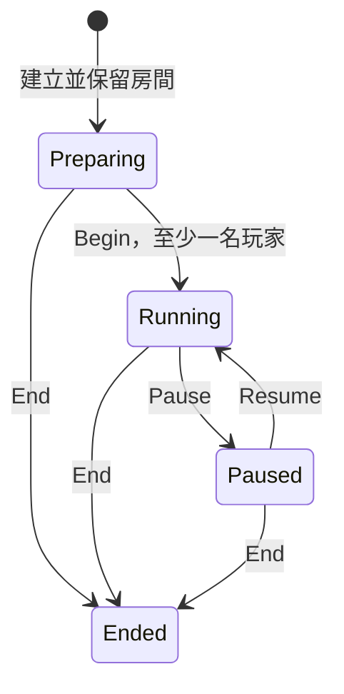

# 場次與事件契約 v0.11

2026-10-31新增[任務計時](MISSION_CLOCK.md)：新寫入envelope7、讀1–7，Preparing的明確SetMissionClock政策與內部End證據持久化。舊場次仍手動；schema7寫入後不得降舊reader。真正PC的Pause／End與封存已驗，以下較早章節保留當時範圍。

本契約目前僅實作管理資料狀態。狀態為 `Running` 不代表已連接遊戲伺服器，`Pause` 尚不會停止頭盔畫面或硬體。

綁定戰鬥來源的場次可在 Pause／End 後補送已保存的 Running 觀察尾端，Ended 時 pendingTelemetry 保持 true 到 seal。新管理操作仍受原生命週期限制；管道／封存格式與完整性邊界見 `TELEMETRY.md`。Unity 有停止／補送來源碼，尚未運行驗證。

## 生命週期



建立時複製任務模板，`CreatedAtUtc` 記錄建立時間；`StartedAtUtc` 在首次 `Begin` 設定，恢復時不覆寫。`EndedAtUtc` 在結束時設定。所有事件時間由後端產生，以序號決定順序，不依賴裝置時鐘。

玩家只可在 `Preparing` 加入，在任一未結束狀態離開。沒有自動開局、倒數結束、斷線偵測、設備準備確認或重連席位。控制台權限見 `AUTHORIZATION.md`。結束時保留當時名冊供歷史查閱，活動名額全部釋放；曾離開的玩家可從事件查閱。

`SetEnvironment` 與 `SetEnemies` 可用於任一未結束狀態。它們更新場次的執行設定，不修改任務模板，也不影響其他獨立場次。已結束的場次拒絕新操作；成功命令的原樣重送仍可查詢接受結果。

## 命令

### 建立與名冊操作

`POST /api/sessions`、`POST /api/sessions/{id}/players`、`DELETE /api/sessions/{id}/players/{playerId}` 支援選用 `Idempotency-Key`，值為一個非空 UUID（`D` 格式）。新操作產生新 key；網路中斷、逾時或 5xx 後重試沿用原 key、路徑、身分與 body。沒有 key 時保留原 API 行為，並不提供重試保證。

去重索引跨這三種操作與全部場次，連同封存歷史保留，沒有自動過期。同 key 必須符合原操作者、操作種類、目標與解析後內容；建立比較完整任務快照，房間順序正規化；加入比較玩家 ID、名稱、房間、頭盔，席位由伺服器固定。改內容／身分／操作回傳 409，每次仍檢查現行房間權限。失敗且未持久化的操作不保留 key，可以原樣重試。

建立重試回傳 201、原場次 Location 與目前快照；加入回傳 200 與目前快照；離開回傳 204。這是原操作已接受的確認，並非重播當時狀態：原場次已結束時建立／加入重試可回傳 Ended，玩家後來離開時加入重試不會重新入場，玩家已重新加入時舊離開重試不會移除新名額。新的入場／離場意圖必須使用新 key 並符合當前狀態。重試沒有新增事件，不會改變新場次的房間保留。

key 與事件在同一 SQLite append 交易中提交；重啟從事件重建索引。這不等同裝置重連、票券一次性、現有遊戲連線撤銷或世界狀態復原。任務儲存及票券配發不採此 key；結束場次仍以既有 `/commands` End 與 commandId 確認結果。

### 控制命令

`POST /api/sessions/{id}/commands`：

```json
{
  "commandId": "251227ab-bc64-4aca-9838-55db6f49dd99",
  "action": "Pause",
  "expectedSequence": 27
}
```

`expectedSequence` 可省略；有指定時必須符合伺服器目前序號，否則回傳 409，讓控制者重新載入再決定。命令重送的去重檢查優先於版本檢查，因此已接受的同一命令即使版本已前進仍能取得結果。

去重範圍是每場次。相同 ID 必須由同一認證身分發出且有完全相同的解析後內容，包含 `expectedSequence`；改變內容或身分回傳 409。回應 `duplicate`、`appliedAtSequence` 表示是否重送及原始接受位置，`session` 一律為最新快照，而非原命令當時的舊狀態。新接受事件與去重資訊一起寫入磁碟，重啟後仍有效。

環境設定範例：

```json
{
  "commandId": "9904f941-aa41-4ca3-808e-8a7efb8677dc",
  "action": "SetEnvironment",
  "environment": { "mode": "VR", "weather": "Rain", "timeOfDay": "Night", "lightning": false }
}
```

敵軍設定範例：

```json
{
  "commandId": "111298ae-c5ce-4746-9e0b-17062e869fae",
  "action": "SetEnemies",
  "enemies": { "count": 8, "behavior": "Advance", "autoAttack": true }
}
```

與動作無關的設定欄位會回傳 400。`commandId` 不可為空 GUID，`action` 不可省略。控制台身分由認證中介層指定，請求 body 的 `actor` 不會改變權限或紀錄來源。

## 事件讀取與持久化

`GET /api/sessions/{id}/events?after=0&limit=100` 回傳事件陣列。每場次從序號 1 開始，僅接受的變更會遞增；讀取端以最後收到的序號作為下一次 `after`，空陣列表示已讀到目前尾端。預設 100、最多 500 筆；沒有訂閱推播與長輪詢。

共同欄位為 `schemaVersion`（新事件為 6）、`eventId`、`sessionId`、`sequence`、`recordedAtUtc`、`kind`、`payload`、`actor` 及可為 null 的 `requestId`。schema 1–5 歷史仍可讀取，schema 1 的 `actor` 保持 null，細節見權限文件。只有 schema 4+ 的 Created／PlayerJoined／PlayerLeft 可以有非空 requestId；跨事件重複 requestId 會使恢復失敗。

| kind | payload | 用途 |
|---|---|---|
| `Created` | mode、roomIds、完整 mission | 建立事件與任務快照 |
| `PlayerJoined` | id、name、roomId、headset、seat | 玩家加入名冊 |
| `PlayerLeft` | playerId、roomId | 玩家離開；schema 4 必須保存當時房間供重試授權 |
| `ControlApplied` | 完整 ControlCommand | 生命週期或執行設定變更 |
| `CombatRecorded` | 完整 CombatReport | 可去重且帶來源標記的戰鬥統計事件，schema 3–5 |
| `CombatStreamOpened` | streamId、origin | Preparing 綁定唯一可信來源，schema 5 |
| `StreamCombatRecorded` | streamId、streamSequence、observedSequence、report | 以原 Running 名冊驗證的有序補送，schema 5 |
| `CombatStreamSealed` | streamId、finalSequence | Ended 的精確尾端確認，schema 5 |

預設儲存於 `SessionDataDirectory/events.db`，每次事件以交易追加後才更新記憶體及統計。單一目錄仍以 `.writer.lock` 限制寫入程序；舊 JSON 歷史會驗證後一次匯入並保留原檔，詳見 `STORAGE.md`。

服務啟動時從事件重建活動與歷史場次，驗證 schema、身分、連續序號、事件／命令 ID、狀態轉移與活動房間／玩家衝突。資料損壞或未知版本時啟動失敗，不靜默丟棄歷史。執行中的場次會恢復管理狀態；此行為尚不涵蓋遊戲世界、裝置重連或硬體恢復。

事件逐筆追加並增量更新統計，但啟動時仍載入所有場次；尚無保留／刪除介面、世界快照或姿態串流。戰鬥事件已有傷害及射擊關聯，仍不包含 3D 位置與動畫，不能視為需求第 9 項的 3D 任務回放。實際遊戲的傳輸與批次寫入將在 Quest 3 垂直切片中整合。


## v0.14 每次入場

PlayerJoined admissionId 等於 EventId，schema 6 持久保存；舊 1–5 從原 EventId 推導，不改寫原事件。PlayerLeft schema 6 另外保存實際 admissionId 及原始 expectedAdmissionId。新 HTTP 移除需要 If-Match-Admission；已接受的同 requestId／原 fence 只確認歷史，改 fence 回 409，不移除後來入場者。票券與共用 binding 同樣檢查本次入場，詳見 [ADMISSION.md](ADMISSION.md)。
